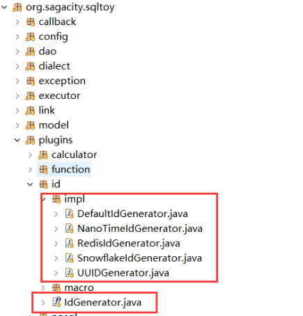
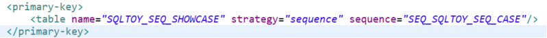
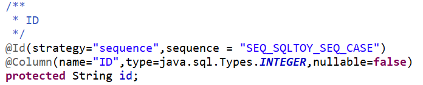
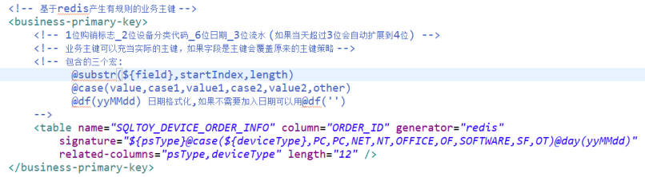
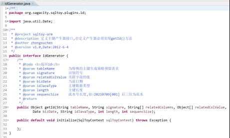
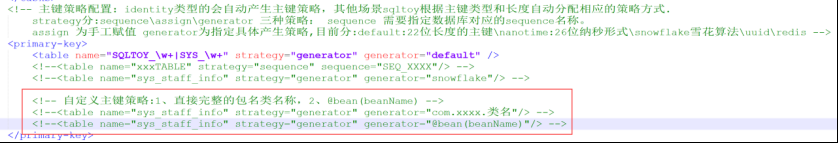

# Primary Key Strategies

SqlToy primary keys fall into two families: **programmatic keys** (produced by the framework or a custom generator, independent of the database) and **database keys** (`sequence` / `identity`, produced by the database). Programmatic keys behave identically across databases and are the recommended choice for productized software.

## 1. Strategy overview

| Strategy keyword (the `generator` value in quickvo / `@Id.generator`) | Implementation (`org.sagacity.sqltoy.plugins.id.impl`) | Shape |
| --- | --- | --- |
| `default` | `DefaultIdGenerator` | 22-digit ordered number: 13-digit current millis + 6-digit nanos + 3-digit host id, e.g. `1592214184072221900219` |
| `nanotime` | `NanoTimeIdGenerator` | 26-digit ordered number: 15-digit `yyMMddHHmmssSSS` + 6-digit nanos + 2 digits (thread id + random) + 3-digit host id |
| `snowflake` | `SnowflakeIdGenerator` | Snowflake, ordered number |
| `uuid` | `UUIDGenerator` | 32-character UUIDv7 (ordered) |
| `ulid` | `ULIDGenerator` | 26-character ordered string: 10 characters of timestamp + 16 of randomness (requires `ulid-creator`) |
| `redis` | `RedisIdGenerator` | Business key: rule-based, e.g. an order number of "date + sequence" |
| `sequence` / `identity` / `assign` | Database or caller | Database sequence / auto-increment column / manual assignment |

> Keywords are case-insensitive; spellings such as `defaultIdGenerator` or `snowflakeIdGenerator` also work (the framework tolerates the naming variants).

The built-in generators (`plugins.id.impl`; the screenshot predates ULID):



`ULID` needs an extra dependency:

```xml
<dependency>
	<groupId>com.github.f4b6a3</groupId>
	<artifactId>ulid-creator</artifactId>
	<!-- adjust the version as needed -->
	<version>5.2.4</version>
</dependency>
```

## 2. Specifying the strategy in quickvo.xml

```xml
<!-- identity columns are detected automatically; everything else is inferred from type/length.
     strategy: sequence (needs a sequence name) | assign (manual) |
               generator (default 22-digit | nanotime 26-digit | snowflake | uuid | ulid | redis | custom class) -->
<primary-key>
    <!-- a regex may match table names in bulk -->
    <table name="SQLTOY_\w+|LESSON_\w+|SYS_\w+" strategy="generator" generator="default" />
    <!-- a database sequence -->
    <table name="XXX_TABLE" strategy="sequence" sequence="SEQ_XXXX" />
    <!-- snowflake -->
    <table name="sys_staff_info" strategy="generator" generator="snowflake" />
</primary-key>
```

**Automatic inference** (when `primary-key` is not configured): `bigint` 鈫?snowflake; a 22-character column 鈫?`DefaultIdGenerator`; a 26-character column 鈫?`NanoTimeIdGenerator`; an `identity` column 鈫?generated by the database, no configuration needed.

A real sequence configuration:



## 3. The generated annotation

Based on that configuration quickvo writes `@Id` onto the primary-key field:

```java
// strategy="generator" with a generator keyword
@Id(strategy = "generator", generator = "org.sagacity.sqltoy.plugins.id.impl.NanoTimeIdGenerator")
@Column(name = "ID", type = java.sql.Types.VARCHAR, length = 26, nullable = false)
private String id;

// strategy="sequence" points at the sequence name
@Id(strategy = "sequence", sequence = "SEQ_XXXX")
@Column(name = "ID", type = java.sql.Types.BIGINT, nullable = false)
private Long id;
```

> `@Id` only describes the generation strategy while `@Column` describes the column; both belong on the primary-key field. See [Annotations Cheat Sheet 路 @Id](../appendix/annotations.md).

What quickvo actually generates (screenshot):



## 4. Redis business keys

The redis strategy belongs to **business keys** (order numbers, document numbers 鈥?keys with a rule). quickvo declares them with `business-primary-key`:

```xml
<!-- macros: @substr(${field},startIndex,length) @case(value,case1,value1,...) @df(yyMMdd)
     use @df('') when no date is wanted; related-columns lists the source fields -->
<business-primary-key>
    <table name="LESSON_DEVICE_ORDER" column="ORDER_ID"
           generator="redis" signature="PO@df(yyMMdd)" length="16" />
</business-primary-key>
```

A fuller real configuration (macro composition plus source fields):



> When the business-key column is itself the primary key (`@Id`), it **overrides** the original key strategy 鈥?the business number becomes the physical primary key; `length` and the sequence digits decide the shape of the number.

Generating keys with redis requires a `RedisTemplate` on the application side.

### @BusinessId and generateBizId

At the configuration level **a table supports only one** business key. When a table needs several, use the `@BusinessId` annotation together with `generateBizId` and assign the values yourself:

```java
/** order number (business key) */
@BusinessId(signature = "HW@case(orderType,SALE,SC,BUY,PO)@day(yyMMdd)",
        generator = "org.sagacity.sqltoy.plugins.id.impl.RedisIdGenerator",
        length = 20, sequenceSize = 5, relatedColumns = {"orderType"})
private String orderId;
```

`@BusinessId` attributes:

| Attribute | Notes |
| --- | --- |
| `signature` | Signature expression, supporting macros such as `@case(name,v1,then1,v2,then2)`, `@day(yyMMdd)` and `@substr(name,start,length)` |
| `generator` | Generator implementation (e.g. `RedisIdGenerator`) |
| `length` / `sequenceSize` | Total key length / trailing sequence digits (-1 uses the global setting) |
| `relatedColumns` | Columns whose values feed the generation |
| `start` | Initial sequence value, default 1 |

Generating through `LightDao`:

```java
// 1) use the @BusinessId strategy configured on the entity
String orderId = lightDao.generateBizId(orderInfo);

// 2) generate with explicit parameters (business keys are managed per table; signature supports @case/@day/@substr)
String bizId = lightDao.generateBizId("sqltoy_order_info",
        "HW@case(orderType,SALE,SC,BUY,PO)@day(yyMMdd)",
        MapKit.map("orderType", "SALE"), null, 20, 5);

// 3) simple form: an identifier plus an increment
long id = lightDao.generateBizId("ORDER", 1);
```

> 馃幀 A complete runnable example lives in `BusinessIdAndDataVersionTest.java` of the `sqltoy-showcase` project (it also demonstrates the `@BusinessId` annotation and is annotated `@Disabled` because it needs redis).

## 5. Using a custom key strategy

Implement the `IdGenerator` interface (package `org.sagacity.sqltoy.plugins.id`; older material often spells it `IdGenarator`, which is a typo):

```java
public interface IdGenerator {
    /**
     * @param tableName       table name (some strategies isolate keys per table)
     * @param signature       signature symbol
     * @param relatedColumns  related column names
     * @param relatedColValue related column values
     * @param bizDate         current date
     * @param idJavaType      Java type of the key
     * @param length          key length
     * @param sequenceSize    sequence digits (e.g. 20210709[001] has three trailing digits)
     */
    public Object getId(String tableName, String signature, String[] relatedColumns, Object[] relatedColValue,
            Date bizDate, String idJavaType, int length, int sequenceSize);

    /** Optional: initialisation, invoked by the framework at startup */
    public default void initialize(SqlToyContext sqlToyContext) throws Exception { }
}
```



Then point `generator` at the implementation in quickvo.xml, in **either of two forms**: the fully qualified class name, or `@bean(beanName)` (the generator is managed by the Spring container, so dependencies can be injected):

```xml
<primary-key>
    <table name="SQLTOY_\w+" strategy="generator"
           generator="com.yourproject.MyIdGenerator" />
    <!-- or: let the Spring container provide it -->
    <table name="SQLTOY_\w+" strategy="generator"
           generator="@bean(myIdGenerator)" />
</primary-key>
```



Or annotate the POJO directly, bypassing quickvo:

```java
@Id(strategy = "generator", generator = "com.yourproject.MyIdGenerator")
```

> If the custom generator depends on Spring beans (a redis template, for instance), obtain them through `initialize(SqlToyContext)` or inside the implementation. Under native images the class needs reflection registration 鈥?see the [GraalVM Native Image Guide](../tools/graalvm_native.md).

## 6. Handling duplicate keys

`default`, `nanotime` and `snowflake` rely on a **host id** to separate workers. Several application instances on one IP will therefore collide, so set it explicitly:

```shell
# default, nanotime: three digits
java -Dsqltoy.server.id=112

# snowflake: two numeric parameters, both below 32
java -Dsqltoy.snowflake.workerId=11
java -Dsqltoy.snowflake.dataCenterId=20
```

> In containers and cloud environments (where pod IPs change), either configure the parameters above explicitly or switch to the `redis` strategy / a custom generator that allocates keys centrally.

## 7. Related

- Attribute tables for `@Id`/`@BusinessId`: [Annotations Cheat Sheet](../appendix/annotations.md)
- Dialect differences when returning inserted keys: [Dialect Adaptation & Functions](../dialect/sqltoy_function.md)
- Key strategy assessment during a database migration: [Database Migration Guide](../introduction/db_migration.md)
